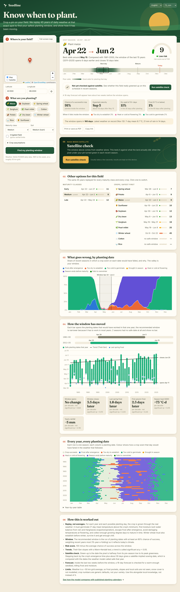

# Seedline

Drop a pin on a map, pick a crop. Seedline pulls 45 years of daily weather for
that exact spot from NASA, shows how the safe planting window has moved over
the decades, and recommends a window for the coming season with a risk score.



## Run it

It is a static site with no build step and no API key.

```bash
npm start
```

Then open http://localhost:8000. Any static file server works (or GitHub
Pages). Tests run with:

```bash
npm test
```

## What it does

- **Full-screen map picker** with place search, then a recommendation: the
  planting window, a 0–100 risk score, and why plantings fail.
- **Eleven crops**, including autumn-sown winter wheat and rice, in three
  maturity classes, on light, medium or heavy soil, rainfed or irrigated.
- **16-day forecast** (Open-Meteo): in the two weeks before the window it
  says plant now or wait, and why (cold seedbed, killing frost, dry soil).
- **Satellite check** (NASA MODIS): compares the model's safe dates with when
  the pixel under the pin actually greened up in recent seasons.
- **Other options for this field**: every maturity class and every crop
  replayed and ranked by risk.
- **How the window has moved**: 1981–2000 against the last 15 years, with
  trend tests on the window, frost dates, season heat and rainfall.
- **Editable crop assumptions**, °C/mm or °F/inches, English, Spanish and
  French, a print layout, shareable links, and offline reuse of the last
  fields through a service worker.
- **A validation page** (`validation.html`) that runs the model for 20
  crop-and-region pairs and scores it against published planting calendars.

## How it works

**Data.** One request to the [NASA POWER](https://power.larc.nasa.gov/) daily
point API returns minimum and maximum temperature, rainfall and solar
radiation from 1981 to this week (`js/power.js`).

**Replay, not averages.** For every year on record and every possible planting
day, the crop is "grown" through the weather that actually followed
(`simulatePlanting` in `js/analysis.js`). A planting succeeds only if it:

1. germinates: the 7-day mean temperature after sowing clears the crop's minimum;
2. establishes: a soil-water bucket (rain in, Hargreaves evapotranspiration
   out, using measured solar radiation) holds enough moisture for three weeks;
3. escapes frost between emergence and maturity;
4. avoids damaging heat during flowering;
5. is not under severe water stress for most of its cycle;
6. accumulates enough growing-degree days to mature before the season ends.

Each failure is labelled with its cause, giving a year × planting-day table of
outcomes that everything else is derived from.

**Recommendation.** Outcomes are pooled across years with recent years
weighted most (15-year e-folding), so the answer reflects today's climate
rather than the 1980s. The window is the run of planting dates with at least
an 80% chance of success; the risk score is 100 minus the average chance of
success inside it.

**Trend detection.** Each year's own safe window, last spring frost, first
autumn frost, season heat and rainfall are tested with a Theil–Sen slope and a
Mann–Kendall significance test, and the 1981–2000 window is compared with the
last 15 years.

**Satellite check.** On request, the app asks NASA's
[ORNL DAAC subset service](https://modis.ornl.gov/data/modis_webservice.html)
for the yearly mid-green-up dates of the pixel under the pin (MCD12Q2, 500 m):
four small requests cover 15 seasons. Stepping back from green-up by emergence
plus about 30 days gives a satellite-implied sowing date, which is compared
with the dates the weather model called safe in that same year (`js/ndvi.js`).
If that product has nothing for the pixel, the app falls back to dating
green-up itself from 16-day NDVI (MOD13Q1, 250 m), one slower request per
season. Autumn-sown crops are excluded: their spring green-up says little
about the sowing date.

**Forecast.** A 16-day Open-Meteo forecast is turned into go / wait advice by
`outlook()` in `js/forecast.js`.

**Validation.** `validation.html` runs the model live for 20 sites. On the
current reference set it scores 12 hits, 6 near and 2 misses; the misses are
irrigated potato in Idaho and rice in Arkansas, and the model tends to open
late in the monsoon tropics. The reference periods in
`js/validation-sites.js` were transcribed from memory of USDA and FAO crop
calendars and still need checking against the sources.

## Layout

| Path | What |
|---|---|
| `js/analysis.js` | The model: water balance, crop replay, windows, trends. No DOM. |
| `js/crops.js` | Crop parameters (GDD base and target, frost and heat limits). |
| `js/power.js` | NASA POWER fetch. |
| `js/ndvi.js` | Satellite check: green-up dating and comparison with the model. No DOM. |
| `js/modis.js` | MODIS green-up and NDVI fetch with retry and browser cache. |
| `js/forecast.js` | Open-Meteo forecast and the plant-now-or-wait rules. |
| `js/i18n.js` | Interface text in English, Spanish and French. |
| `js/validation-sites.js`, `js/validate.js`, `validation.html` | Validation against planting calendars. |
| `sw.js` | Service worker: network first, cache as the offline fallback. |
| `js/app.js` | Map, controls and charts. |
| `test/` | Unit tests on synthetic climates. |
| `vendor/leaflet/` | Leaflet 1.9.4 (BSD-2-Clause), vendored so the demo has no CDN dependency. |

## Limits

- POWER weather is a roughly 50 km grid average. Frost pockets, slopes and
  local soils are invisible to it, and grid-average minimum temperatures run
  warmer than a cold hollow.
- Crop parameters are generic rules of thumb that no agronomist has reviewed.
  They can be edited in the app ("Crop assumptions") or in `js/crops.js`.
- Soil is one bucket of 60, 100 or 150 mm. Snow cover is not modelled, so
  winterkill of winter wheat is overstated in snowy continental climates.
- Rice is modelled as a warm-season crop with high water needs, not as a
  flooded paddy; tick "Irrigated field" for paddy rice.
- The satellite check sees one pixel, which may be pasture, trees, a town or
  a different crop. The 30-day green-up lag is a rule of thumb.
- Spanish and French text was machine-written and needs a native review.
- The open-water check is a heuristic (sea-level point with almost no
  day-night temperature swing), not a land mask.

## Next

- Verify the validation reference dates against the USDA and FAO sources.
- Have an agronomist review `js/crops.js`.
- Snow cover for winter crops; a proper land-cover mask for the pin.
